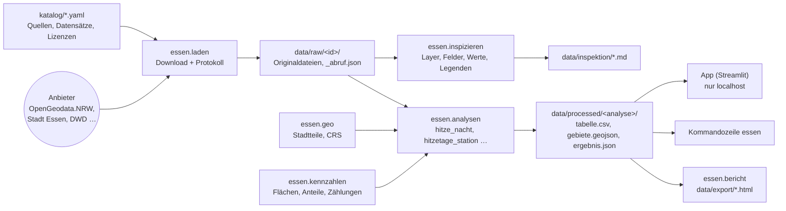

# Aufbau des Projekts

Das Projekt ist ein privates Analysewerkzeug für die öffentlichen Daten der Stadt Essen. Es besteht aus
einem Python-Paket mit der ganzen Logik und zwei dünnen Oberflächen darüber: der Kommandozeile `essen`
und einer lokalen App. Daten liegen nie im Repository; jede Person lädt sie selbst aus der Originalquelle.

## Datenfluss



## Schichten

| Schicht | Module | Aufgabe | Darf nicht |
| --- | --- | --- | --- |
| Katalog | `katalog.py`, `katalog/*.yaml` | einzige Stelle für Adressen, Lizenzen, Download-Angaben | Daten laden |
| Laden | `laden.py`, `dienste.py` | Download, Entpacken, Protokoll, WMS/WFS befragen | rechnen |
| Raum | `geo.py` | Stadtteile lesen, Felder erkennen, Koordinatensysteme | themenspezifisch werden |
| Verstehen | `inspizieren.py`, `legenden.py`, `vorschau.py` | unbekannte Dateien beschreiben und ansehen | Daten verändern |
| Rechnen | `kennzahlen.py`, `analysen/` | allgemeine Bausteine und fertige Analysen | Oberfläche kennen |
| Zeigen | `karte.py`, `diagramme.py`, `punktebenen.py`, `bericht.py`, `steckbrief.py`, `zeitreihen.py`, `einordnung.py`, `begriffe.py`, `hilfetexte.py`, `app/`, `cli.py` | Karten, Seiten, Bedienung | eigene Rechnungen enthalten |

Die Abhängigkeiten zeigen nur nach unten: Die App ruft Analysen auf, nie umgekehrt. Deshalb lässt sich die
Oberfläche austauschen (siehe `docs/entscheidungen.md`, E-004), ohne an der Rechnung etwas zu ändern.

## Ordner

```
essen-daten/
├── AGENTS.md              Arbeitsanleitung für Coding-Agenten (und Menschen)
├── CLAUDE.md              bindet AGENTS.md für Claude Code ein
├── README.md              Einrichten und Starten
├── pyproject.toml, uv.lock, .python-version
├── .streamlit/config.toml App nur auf localhost, keine Telemetrie
├── .claude/
│   ├── settings.json      Hook für Cloud-Sitzungen (scripts/cloud-setup.sh)
│   └── skills/            Anleitungen für wiederkehrende Aufgaben
├── katalog/
│   ├── lizenzen.yaml
│   ├── quellen.yaml       Anbieter und Portale (39)
│   ├── datensaetze.yaml   einzelne Datensätze mit Download-Angaben (49)
│   └── zuordnungen/       geprüfte Wertezuordnungen, z. B. Rasterklassen
├── src/essen/             das Paket (siehe Schichten)
│   ├── analysen/          eine Datei je Analyse, Registry in __init__.py
│   └── app/               Streamlit: start.py, gemeinsam.py, seiten/
├── docs/                  Architektur, Entscheidungen, Methodik, Fahrplan, Datenquellen
├── tests/                 pytest, nur mit erfundenen Testdaten
├── scripts/cloud-setup.sh
├── data/                  (nicht im Repository) raw, processed, inspektion, zuordnungen, export
└── data_test/             (nicht im Repository) erfundene Testdaten
```

## Die App

Die App ist eine Streamlit-Anwendung, die mit `uv run essen app` startet. Sie hört nur auf `localhost`,
schickt keine Nutzungsstatistik und lädt außer den Daten nur Kartenkacheln (basemap.de), Leaflet und
eingeblendete Kartendienste nach.

Die Navigation hat zwei Bereiche. **Essen entdecken** ist für Menschen ohne Vorwissen: Die Seiten lesen nur
gespeicherte Ergebnisse, erklären jede Zahl in Worten und haben oben den Kasten „So funktioniert diese Seite“.
Die **Werkstatt** enthält alles zum Laden, Rechnen und Prüfen. Texte für Menschen liegen im Paket:
`essen.hilfetexte` (je Seite), `essen.begriffe` (Glossar), `essen.einordnung` (Zahlen als Sätze, Richtung
gut/schlecht) und die Erklärfelder jeder Analyse (`thema_titel`, `kurz`, `richtung`, `lesehilfe`, `grenzen_kurz`).

| Bereich | Seite | Zweck |
| --- | --- | --- |
| Essen entdecken | Start | Fragen als Einstieg, Kernaussagen für Essen |
| | Mein Stadtteil | alle Themen eines Stadtteils, in Worten eingeordnet, mit Karte |
| | Themen | ein Thema lesen: Aussage, Karte, Rangliste, Lesehilfe, Grenzen, Begriffe, Methodik |
| | Karte | Thema einblenden, Kartendienste der Anbieter (eingeklappt) |
| | Themen vergleichen | Streudiagramm zweier Themen, Zusammenhang in Worten |
| | Entwicklung über die Jahre | Stationsreihen mit Trend und Grenzwerten |
| | Begriffe erklärt | Glossar mit Suche |
| Werkstatt | Alles vorbereiten | alle nötigen Daten laden und alle Themen rechnen (`essen.vorbereiten`) |
| | Daten laden | alle Datensätze mit Lizenz, Status und Knopf zum Herunterladen; Datei-Übernahme |
| | Neu berechnen | Daten, Einstellungen (häufige sichtbar, seltene eingeklappt), Berechnen, Downloads |
| | Daten untersuchen | Bericht über einen geladenen Datensatz |
| | Schnellanalyse | beliebigen Vektordatensatz auf die Stadtteile verteilen |
| | Quellen und Portale | alle Anbieter mit Schnittstellen, Hinweisen und bekannten Lücken |
| | Methodik und Lizenzen | Rechenwege, Lizenzen, Quellenangaben aller geladenen Daten |

So läuft ein Download aus der App: Der Knopf ruft `laden.hole()` auf. Die Funktion löst bei Download-Ordnern
den Dateinamen über `index.json` oder die Linkliste auf, lädt in eine `.part`-Datei, rechnet dabei die
SHA-256-Prüfsumme, benennt erst am Ende um und schreibt `_abruf.json` sowie eine Zeile in
`data/abrufe.csv`. Passen mehrere Dateien zum Muster, fragt die App nach. Bei Dateien ab 500 MB muss man
den Platz bestätigen.

## Erweitern

| Vorhaben | Wo | Anleitung |
| --- | --- | --- |
| neue Datenquelle oder neuer Datensatz | `katalog/*.yaml` | Skill `neue-datenquelle` |
| unbekannte Daten verstehen | `essen inspizieren` | Skill `daten-inspizieren` |
| neue Kennzahl oder Analyse | `src/essen/analysen/` | Skill `neue-analyse` |
| Karte, Farben, Export | `karte.py`, `bericht.py` | Skill `karte-gestalten` |
| Weitergabe oder Veröffentlichung | Lizenzen, Quellenangaben | Skill `lizenz-pruefen` |
| neue Seite oder Bedienung in der App | `src/essen/app/` | Skill `app-erweitern` |

## Konventionen

- Flächen in EPSG:25832, Webkarten in EPSG:4326. Flächen in ha, Anteile in Prozent mit einer Nachkommastelle.
- Spaltennamen in Ergebnissen: `gebiet_id`, `stadtteil`, `stadtteil_nr`, Einheiten als Endung (`_ha`, `_pct`, `_c`, `_mm`).
- Bezeichner deutsch ohne Umlaute (`flaeche_ha`), Texte für Menschen mit Umlauten.
- Fehlermeldungen sagen, was zu tun ist (`DatenFehlen` nennt den Befehl zum Laden).
